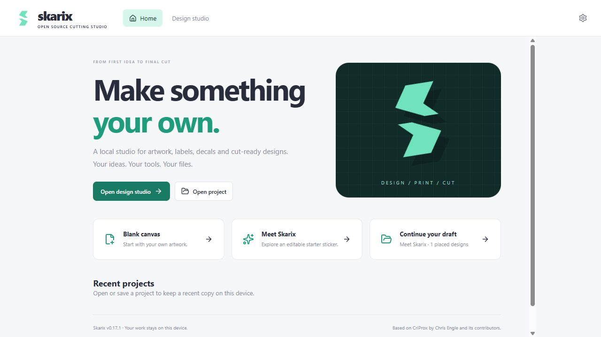
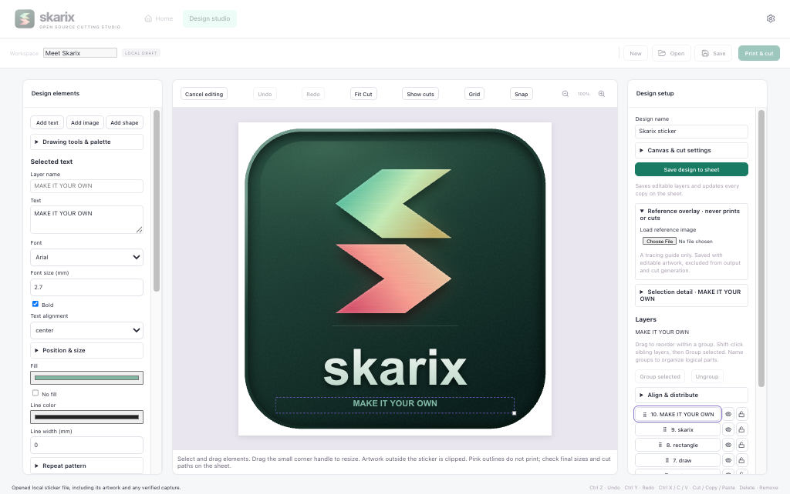

# Skarix — Open Source Cutting Studio

Make artwork, labels, decals and cut-ready designs in a local desktop studio.

This branch introduces Skarix. Published v0.17.1 installers still contain the earlier CriProx interface; a Skarix release has not been published.



## Why Skarix?

| Feature | What you can do |
| --- | --- |
| **Your own studio** | Start blank, continue your draft, or explore the editable Skarix starter sticker. |
| **Editable artwork** | Combine shapes, Bézier paths and text on a path with gradients, textures, shadows and photo adjustments. Group, align, lock and hide layers. |
| **Precise layouts** | Work in physical dimensions, snap to a grid, align artwork, nest copies and inspect cut boundaries. |
| **Print and cut** | Generate marked sheets and matching contours, choose materials and inspect output. |
| **Local projects** | Save portable files and keep a local draft. Existing sticker projects remain compatible. |
| **Optional AI design** | Connect an MCP client to edit artwork and layouts. Operate printers and cutters yourself. |

## From artwork to cut

1. Choose **Meet Skarix**, **Blank canvas**, or **Open project**.
2. Create or import artwork in **Design studio**. Use **Add shape** for presets, expand the appearance controls you need, then set dimensions and the cut outline.
3. Arrange copies and choose machine, paper, and material.
4. Open **Print & cut**, inspect the pages, and print at actual size.
5. Review the matching cut job and operate the cutter. Read the [print guide](docs/CRICUT-WORKFLOW.md) first.

## Run locally

Use Node.js 22 or newer:

```sh
npm ci
npm run desktop
```

Use `npm run dev` for browser development. Direct cutter access and desktop printing require Electron. Run `npm test` and `npm run build` before submitting changes.

[Installation](docs/INSTALLATION.md) · [Features](docs/FEATURES.md) · [AI design](docs/AI-DESIGN-MCP.md) · [Architecture](docs/ARCHITECTURE.md)



## Existing projects

The gaming-card workspace and its catalog integrations are removed. Existing user files are not deleted or rewritten. Existing sticker/design projects open in Skarix. Home offers export copies of preserved legacy projects for continued use in CriProx.

Storage identifiers and the installation ID remain unchanged for continuity. An existing draft always takes precedence over the starter. New portable files use `.skarix.json`.

## License and credits

Skarix is based on [CriProx](https://github.com/Go2Engle/CriProx), created by [Chris Engle (Go2Engle)](https://github.com/Go2Engle) and its original contributors. Original copyright notices and GPL-3.0-only licensing remain in [NOTICE](NOTICE) and [LICENSE](LICENSE).

Please preserve upstream attribution and copyright notices. Skarix is licensed under GPL-3.0-only. See [CONTRIBUTING.md](CONTRIBUTING.md), [LICENSE](LICENSE), [NOTICE](NOTICE), and [THIRD_PARTY_LICENSES.txt](THIRD_PARTY_LICENSES.txt). Skarix is independently maintained and not affiliated with Cricut.
